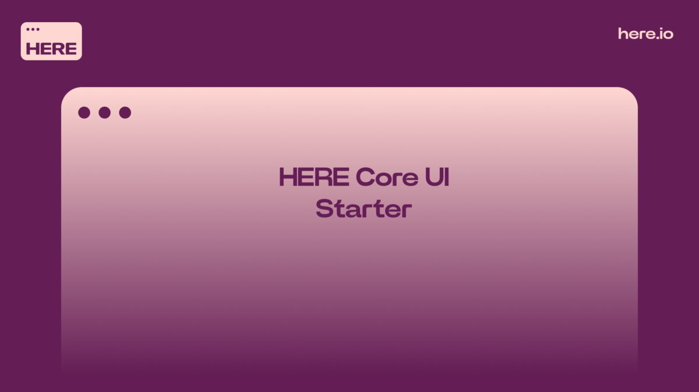

> **_:information_source: HERE Core UI:_** [HERE Core UI](https://resources.here.io/docs/core/hc-ui/) is a commercial product and this repo is for evaluation purposes (See [LICENSE.MD](LICENSE.MD)). Use of the HERE Core Container and HERE Core UI components is only granted pursuant to a license from HERE (see [manifest](public/manifest.fin.json)). Please [**contact us**](https://www.here.io/contact) if you would like to request a developer evaluation key or to discuss a production license.

# Use Notification Center Theming

This example shows a minimal HERE Core UI Platform that:

- Initializes the platform without registering Home, Store or Dock.
- Launches a default snapshot from the [manifest](public/manifest.fin.json) with a single custom platform window ([window.html](public/platform/window.html)) containing two views stacked one on top of the other. The top view shows `https://www.microsoft.com`, the bottom view shows `https://www.google.com`.
- Replaces the default browser window with the custom window by setting `url` and `workspacePlatform.windowType: "platform"` in `defaultWindowOptions` (and on the manifest snapshot window). The `url` is ignored unless the window type is `platform`.
- The custom window has no minimize or maximize buttons. Its title bar has three buttons:
  - A light bulb button which toggles the platform color scheme between `light` and `dark`. The Notification Center follows the change and the window recolors itself to match.
  - An **Exit Platform** button which clears the sample notification, deregisters from the Notification Center and quits the platform.
  - A close button which closes the window.
- Defines a theme object for the Notification Center with a default `light` scheme and passes it to the Notification Center.
- Starts the Notification Center by registering the platform with it and raises a notification that uses the theme.
- The notification uses a custom template whose colors come from the palette of the current scheme, and has an **Open NC** button. Clicking the button raises a `notification-action` event which the platform handles by calling `Notifications.show()` to open the Notification Center. When the scheme is toggled the notification is cleared and raised again with the colors of the new scheme.

This example assumes you have already [set up your development environment](https://resources.here.io/docs/core/develop/)

## How the custom window talks to the platform

The window page runs in its own window, so it publishes messages on the `fin.InterApplicationBus` and the platform provider ([provider.ts](client/src/provider.ts)) listens for them:

| Topic                                 | Direction        | Purpose                                        |
| ------------------------------------- | ---------------- | ---------------------------------------------- |
| `notification-center-theming-toggle`  | window → provider | Light bulb clicked, toggle the scheme          |
| `notification-center-theming-exit`    | window → provider | Exit clicked, tear down and quit the platform  |
| `notification-center-theming-request` | window → provider | Window loaded, request the current scheme      |
| `notification-center-theming-scheme`  | provider → window | Current scheme (`light` or `dark`)             |

The provider changes the scheme with `platform.Theme.setSelectedScheme`, which is what updates the Notification Center.

## How the Notification Center is themed

The Notification Center is not started automatically. Calling `Notifications.register` from `@openfin/workspace/notifications` launches it and registers your platform.

During registration the Workspace notifications API reads the theme that was supplied to the platform `init` call and sends it to the Notification Center. Because of this the theme object (`notificationCenterTheme` in [provider.ts](client/src/provider.ts)) is passed in the `theme` array of `init`, and it reaches the Notification Center when `register` is called.

The theme is a `CustomThemeOptionsWithScheme` which has:

- `default: "light"` so the light palette is used unless the user selects a different scheme.
- `palettes.light` and `palettes.dark` palettes.
- `notificationIndicatorColors` which defines a custom `brand` indicator color that notifications can target.

## Getting Started

1. Install dependencies and do the initial build. Note that these examples assume you are in the sub-directory for the example.

```shell
npm run setup
```

2. Optional (if you wish to pin the version of HERE Core UI to version 24.0.24 and you are on Windows) - Set Windows registry key for [Desktop Owner Settings](https://resources.here.io/docs/core/manage/desktops/dos/).
   This example runs a utility [dos.mjs](./scripts/dos.mjs) that adds the Windows registry key for you, pointing to a local desktop owner
   settings file so you can test these settings. If you already have a desktop owner settings file, this script prompts to overwrite the location. Be sure to capture the existing location so you can update the key when you are done using this example.

   (**WARNING**: This script kills all open HERE processes. **This is not something you should do in production to close apps as force killing processes could kill an application while it's trying to save state/perform an action**).

```shell
npm run dos
```

3. Start the test server in a new window.

```shell
npm run start
```

4. Start Your HERE Core UI Platform.

```shell
npm run client
```

5. Build the project if you modify the code.

```shell
npm run build
```

---

### Read more about [working with Workspace](https://resources.here.io/docs/core/hc-ui/)
